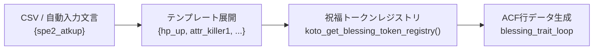

# 祝福トークン作成・運用ガイドライン

本書は、コトダマンDBの祝福・EX祝福自動入力システムにおける「**祝福トークン**」の構造、追加手順、ACFフィールドグループとの対応関係、およびテンプレート連携の手法をまとめた開発・保守ガイドです。

---

## 1. 祝福トークンシステムの概要

祝福自動入力では、頻出する祝福の構成（HPアップ、属性キラー、種族キラー、グループドローバフなど）を短い「**トークン識別子**」として抽象化し、テンプレート記法で効率的に展開します。



* **定義場所**: [lib/acf/auto-input/acf-auto-input-blessing.php](file:///var/www/html/wp-content/themes/cocoon-child-master/lib/acf/auto-input/acf-auto-input-blessing.php) の `koto_get_blessing_token_registry()`
* **対応ACFグループ**: `group_693971a11a6b2.json`（キャラクター祝福とくせい）

---

## 2. トークン定義のプロパティ一覧

トークンレジストリ（`koto_get_blessing_token_registry()`）に登録する連想配列のキー仕様です。

| キー | 型 | 必須 | 説明 | 指定例 |
| :--- | :--- | :---: | :--- | :--- |
| `label` | `string` | ◯ | 管理画面・表示用の名称 | `'属性キラー30%'` |
| `trait_type` | `string` | ◯ | ACFの「とくせいタイプ」選択肢キー | `'status_up'`, `'damage_correction'`, `'draw_eff'` 等 |
| `pt_pattern` | `string` | ◯ | ACFの「祝福ポイントタイプ」 | `'default'` (通常1〜20), `'single'` (非レベル制), `'csv'` (手動) |
| `target_type` | `string` | ◯ | 対象の種別 | `'self'`, `'attr'`, `'species'`, `'affiliation'` |
| `rate_type` | `string` | ◯ | 数値の単位 | `'fixed'` (固定値), `'percentage'` (%) |
| `blessing_level_value` | `string` | △ | レベルごとの数値タイプ（`pt_pattern === 'default'` 時） | `'min_max'` (等差数列), `'csv'` (カンマ区切り) |
| `need_point` | `string` | △ | 必要祝福ポイント（`pt_pattern === 'single'` 時） | `'20'`, `'30'` |
| サブ効果キー | `string` | △ | 各 `trait_type` に従属するACF選択肢フィールド | `'status_up' => 'hp'`, `'draw_eff' => 'atk_buff'` 等 |
| `draw_triat_turn` | `string` | △ | ドロー時効果のターン数（ACFの歴史的タイポ） | `'2'` |
| `rarity_values` | `array` | ◯ | レアリティ（`star6`, `star5`）ごとの数値定義 | 下記参照 |

### `rarity_values` の書き方

レアリティ（★6 / ★5）ごとに数値を切り替えます。★5キャラの場合はこの設定値が自動適用されます。

```php
'rarity_values' => [
    // 等差数列型（min_max）の場合
    'star6' => ['min_value' => '10', 'max_value' => '20'],
    'star5' => ['min_value' => '5',  'max_value' => '15'],

    // 固定値型（single）の場合
    'star6' => ['blessing_value' => '30', 'need_point' => '20'],
    'star5' => ['blessing_value' => '25', 'need_point' => '20'],

    // カンマ区切りCSV型の場合（末尾「!」は手動固定表記）
    'star6' => ['blessing_value' => '200!'],
    'star5' => ['blessing_value' => '100,125,150,175,200,230,260,290,320,350'],
]
```

---

## 3. ターゲット（`target_type`）別の仕様と解決フロー

| `target_type` | 説明 | テンプレート指定方法 | 自動解決の仕組み |
| :--- | :--- | :--- | :--- |
| **`self`** | 自身 | `hp_up`, `atk_up`, `dodge` | `target_type: self` のみセット |
| **`attr`** | 属性 | `attr_killer1`, `attr_killer2` | `attrs` 配列のインデックス（1始まり）からタームIDを自動解決 |
| **`species`** | 種族 | `species_killer1`, `species_killer2` | `species` 配列のインデックス（1始まり）からタームIDを自動解決 |
| **`affiliation`** | 所属グループ | `group_draw_buff` | 対象キャラの投稿（`post_id`）に設定されている `affiliation` タクソノミー（または入力引数）からタームIDを自動抽出して `target_group` に流し込み（ACF値は `group`） |

---

## 4. トークン作成の実例

### 例1: レベル制等差キラー（属性キラー）
```php
'attr_killer' => [
    'label'                => '属性キラー',
    'trait_type'           => 'damage_correction',
    'damage_correction'    => 'killer',
    'rate_type'            => 'percentage',
    'pt_pattern'           => 'default',
    'blessing_level_value' => 'min_max',
    'target_type'          => 'attr',
    'rarity_values'        => [
        'star6' => ['min_value' => '10', 'max_value' => '20'],
        'star5' => ['min_value' => '5',  'max_value' => '15'],
    ],
],
```

### 例2: 非レベル制の固定値キラー（30%属性キラー）
```php
'attr_killer_30' => [
    'label'                => '属性キラー30%',
    'trait_type'           => 'damage_correction',
    'damage_correction'    => 'killer',
    'rate_type'            => 'percentage',
    'pt_pattern'           => 'single',
    'target_type'          => 'attr',
    'rarity_values'        => [
        'star6' => ['blessing_value' => '30'],
        'star5' => ['blessing_value' => '25'],
    ],
],
```

### 例3: 所属連動のドローバフ（グループドローバフ）
```php
'group_draw_buff' => [
    'label'                => 'グループドローバフ',
    'trait_type'           => 'draw_eff',
    'draw_eff'             => 'atk_buff',
    'draw_triat_turn'      => '2',
    'rate_type'            => 'fixed',
    'pt_pattern'           => 'single',
    'need_point'           => '20',
    'target_type'          => 'affiliation',
    'rarity_values'        => [
        'star6' => ['blessing_value' => '1', 'need_point' => '20'],
        'star5' => ['blessing_value' => '1', 'need_point' => '20'],
    ],
],
```

---

## 5. 新規トークン作成の Step-by-Step

新しい祝福トークンを追加する際の手順です。

### Step 1: ACF JSON でフィールド名と選択肢を確認
* [acf-json/group_693971a11a6b2.json](file:///var/www/html/wp-content/themes/cocoon-child-master/acf-json/group_693971a11a6b2.json) を確認し、`trait_type`、サブ選択肢（`choices`）、および必要なサブフィールドのキー名を確認します。

### Step 2: `koto_get_blessing_token_registry()` に定義を追加
* [lib/acf/auto-input/acf-auto-input-blessing.php](file:///var/www/html/wp-content/themes/cocoon-child-master/lib/acf/auto-input/acf-auto-input-blessing.php) の `koto_get_blessing_token_registry()` 配列へ新規トークンを定義します。

### Step 3: `koto_build_blessing_token_row()` への反映確認
* 新規トークンで使用する特殊なフィールドがある場合、`koto_build_blessing_token_row()` がそのキーを保持して行配列に代入しているか確認します。

### Step 4: テンプレート逆抽出（`koto_extract_blessing_template_from_post`）に対応
* 既存キャラのデータから逆抽出する際、該当するトークン名として認識されるよう `koto_extract_blessing_template_from_post()` の条件分岐に追加します。

### Step 5: CSV の「祝福テンプレート」に組み込む
* [lib/ゲーム内文言ーACF-対応表.csv](file:///var/www/html/wp-content/themes/cocoon-child-master/lib/ゲーム内文言ーACF-対応表.csv) の最下部「祝福テンプレート」セクションに、登録したトークンを含むパターン（例: `{hp_up,attr_killer1,group_draw_buff}`）を追加します。

### Step 6: 動作検証と回帰テスト
* 構文チェック: `php -l lib/acf/auto-input/acf-auto-input-blessing.php`
* 回帰テスト: `php lib/acf/test_auto_input.php`

---

## 6. 便利な逆抽出 CLI（既存キャラからのトークン抽出）

既存キャラクターが持っている祝福設定から、テンプレート文字列をワンライナーで逆生成できます。

```bash
# 投稿ID 5045 の祝福からテンプレート定義を抽出して表示
php lib/acf/test_auto_input.php --extract-blessing 5045 spe_custom
```

**出力例**:
```text
■ 抽出元 Post ID: 5045 (健闘！声援！・ダンチレベチ(運動会))
■ CSV追記用1行:
祝福テンプレート,spe_custom,"{hp_up,attr_killer1,species_killer1,attr_mitigation1,species_killer2,group_draw_buff,species_killer3}"
```
この行をそのまま `lib/ゲーム内文言ーACF-対応表.csv` に貼り付けることで、新しいテンプレートパターンを瞬時に作成できます。
