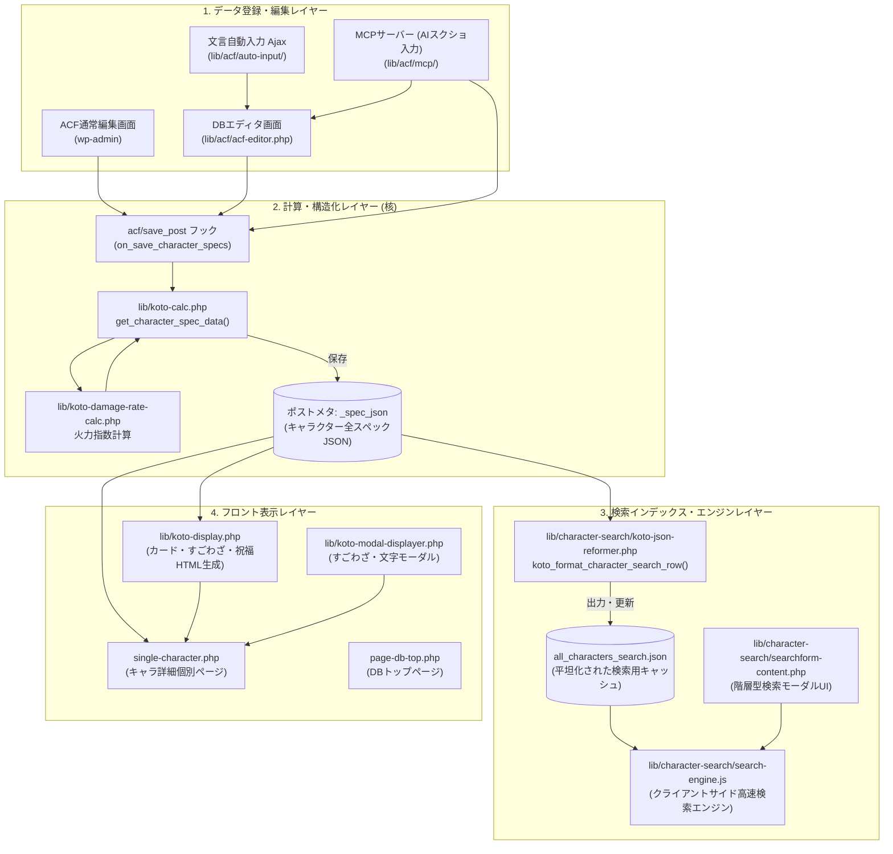
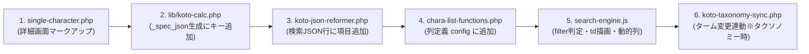

# コトダマンDB コードマップ＆システムアーキテクチャ（AI時短リファレンス）

本書は、コトダマンDB（`cocoon-child-master`）の全体アーキテクチャ、データフロー、ファイル責務、および機能追加時の「変更連動チェックリスト」を網羅したリファレンスマニュアルです。
AIエージェントおよび開発者が、手探りのファイル探索（grep / find の繰り返し）を行わず、最小の手数で目的のコードへ到達・編集できるようにすることを目的としています。

---

## 1. システムアーキテクチャ＆データフロー

コトダマンDBは、**ACF/MCP等によるデータ入力** → **`koto-calc.php` による構造化（`_spec_json` 生成）** → **検索用JSON平坦化 / 詳細画面描画** というパイプラインで構築されています。

### ① 全体データフロー図



---

## 2. ディレクトリ＆ファイル責務マップ

### ① 計算・データ構造化（コアロジック）
| ファイルパス | 責務・主要関数 | 備考 |
| :--- | :--- | :--- |
| `lib/koto-calc.php` | **最重要ファイル**。`get_character_spec_data($post_id)` によりACFの全データを読み込み、わざ・すごわざ・リーダー・とくせい・祝福・EX祝福・火力指数を解析して構造化配列を返却。`on_save_character_specs()` で `_spec_json` に保存。 | 新規ステータスやタグ追加時は必ずここを修正 |
| `lib/koto-damage-rate-calc.php` | わざ・すごわざの火力指数（ATK倍率・キラー・バフデバフ）を算出する計算エンジン。 | `koto-calc.php` から呼び出し |
| `lib/koto-variables.php` | 属性、種族、状態異常、とくせい検索タグの日本語名マッピング（`koto_get_trait_search_label_map()`）等の定数定義。 | 検索タグ新設時にラベルを追記 |
| `lib/koto-helpers.php` | 全域で使われる共通ユーティリティ（文字列処理、配列整形等）。 | |

### ② キャラクター検索モジュール（`lib/character-search/`）
| ファイルパス | 責務・主要関数 | 備考 |
| :--- | :--- | :--- |
| `koto-json-reformer.php` | `_spec_json` から検索用JSON（`all_characters_search.json`）の行データ（`waza_t`, `sugo_t`, `trait1_en`/`jp`, `blessing_en`/`jp` 等）へ平坦化・正規化する関数群。 | 検索タグ正規化 `koto_normalize_trait_search_slug()` を含む |
| `search-engine.js` | クライアントサイド検索エンジン。タグ合致判定、アクティブ条件判定、テーブル行HTML生成（`createCharacterRowHtml`）、動的列表示制御（`updateDynamicColumns`）。 | テーブルに列を追加する際はここを修正 |
| `chara-list-functions.php` | 検索結果テーブルの列定義（`koto_get_column_config()`）や、表示項目トグルチェックボックスの生成。 | 新規列追加時はここへ設定追加 |
| `searchform-content.php` | 検索モーダルのHTMLマークアップ（属性、種族、状態異常、階層型とくせいチェックボックス等）。 | チェックボックス追加時はここ |
| `searchform.js` / `.css` | 検索モーダルのUI制御（階層チェックボックスのTri-State連動、タブ切り替え、開閉アニメーション）。 | |
| `koto-search.php` | 検索関連の初期化・スクリプト登録・Ajaxエンドポイント。 | |
| `koto-taxonomy-sync.php` | タクソノミーターム変更時に `_spec_json` 内の該当キーを連動更新するフック。 | |

### ③ ACF自動入力モジュール（`lib/acf/auto-input/`）
| ファイルパス | 責務・主要関数 | 備考 |
| :--- | :--- | :--- |
| `acf-auto-input-ajax.php` | 自動入力のAjaxエンドポイント（`wp_ajax_koto_auto_input_parse`）。 | 入力受取・レスポンス返却 |
| `acf-auto-input-blessing.php` | 祝福・EX祝福のゲーム内文言を解析し、文字追加・すごわざ条件追加・とくせい行を構築。 | `AUTO_INPUT_GUIDELINES.md` 参照 |
| `acf-auto-input-blessing.php` | 祝福・EX祝福のゲーム内文言を解析し、文字追加・すごわざ条件追加・とくせい行を構築。 | `documents/blessing-token-guide.md` 参照 |
| `acf-auto-input-parsers.php` | 通常わざ・すごわざ・リーダー・通常とくせいの文言パースエンジン。 | 句点分割・丸数字分割・正規表現 |
| `acf-auto-input-helpers.php` | CSV対応表のロード、文言正規化（全角半角、濁点等）、類似度判定。 | |
| `acf-auto-input-wp-acf.php` | 解析結果の配列を ACF PRO の `field_xxxxxx` キー形式に変換し、DB保存・下書き保存を実行。 | サブフィールド競合防止の要 |
| `AUTO_INPUT_GUIDELINES.md` | 自動入力の文言解析仕様、シフトタイプ、CSVマッピング記法マニュアル。 | ルール変更時に必読 |
| `documents/blessing-token-guide.md` | 祝福トークン定義、レアリティ値、所属連動、逆抽出CLIマニュアル。 | トークン追加時に必読 |
| `lib/ゲーム内文言ーACF-対応表.csv` | ゲーム内文言とACFフィールド値のマッピングマスターデータ。 | |

### ④ 専用DBエディタ（`lib/acf/`）
| ファイルパス | 責務・主要関数 | 備考 |
| :--- | :--- | :--- |
| `acf-editor.php` | コトダマンDB専用のACF編集画面テンプレート。文字入力欄、わざ・すごわざタブ、とくせい・祝福リピーターUIを描画。 | |
| `acf-editor.js` / `.css` | 専用エディタのDOM制御、ショートカット（並べ替え/行追加）、`beforeunload` 自動保存。 | |
| `acf-auto-input.js` | 専用エディタ上の「自動入力」ボタン、文言貼り付けモーダル、Ajax送信・フォーム反映。 | |

### ⑤ MCPサーバー（`lib/acf/mcp/`）
| ファイルパス | 責務・主要関数 | 備考 |
| :--- | :--- | :--- |
| `server.php` | Model Context Protocol（MCP）JSON-RPC 2.0 サーバー。ツール呼び出し・リソース配信の受付。 | |
| `mcp-tools.php` | MCPツールのディスパッチ（`preview_draft`, `create_draft`, `update_draft`, `validate`, `search_character`, `get_blessing_schema` 等）。 | |
| `mcp-schema.php` | ACFフィールドスキーマ動的生成、祝福・EX祝福スキーマ＆トークン辞書生成（`koto_mcp_blessing_schema`）。 | |
| `mcp-draft.php` | 下書き（Draft）の生成・更新・バリデーションロジック、雛型記事保護チェック。 | |
| `mcp-resources.php` | MCPクライアント向けドキュメント・スキーマ（`kotodaman://guide/...`）の配信。 | |
| `mcp-auth.php` / `mcp-oauth.php` | OAuth 2.1 Bearer 認証および Application Passwords 認証、権限管理。 | |
| `prepare_screenshots.php` | スクショ画像の一括トリミング・タイル結合スクリプト（`contact_sheet.jpg` 生成）。 | |

### ⑥ フロント表示レイヤー
| ファイルパス | 責務・主要関数 | 備考 |
| :--- | :--- | :--- |
| `single-character.php` | キャラクター個別詳細ページ。基本情報、わざ・すごわざ・とくせい・祝福カードのレイアウト。 | |
| `lib/koto-display.php` | `_spec_json` を元にすごわざHTML（`get_koto_sugowaza_html`）や祝福カードHTML（`get_koto_blessing_card_html`）を生成。 | 表示系マークアップの集約先 |
| `lib/koto-modal-displayer.php` | コトワザ詳細や文字追加モーダル等のポップアップHTML生成。 | |
| `style-character-detail.css` | キャラクター詳細ページの専用スタイルシート（インラインスタイル禁止）。 | |
| `style-character-search.css` | キャラクター検索画面の専用スタイルシート。 | |

### ⑦ 補助・管理系ツール（`lib/`）
| ファイルパス | 責務・主要関数 | 備考 |
| :--- | :--- | :--- |
| `lib/image-setter/` | キャラクター画像紐付けツール（進化後、進化前、絵違い、アイキャッチ）。Ajaxページネーション `LIMIT 60`。 | |
| `lib/term-setter/` | タクソノミー（所属、グループ等）一括設定ツール。 | |
| `lib/missing-info-characters.php` | 画像や情報が未設定のキャラクターを抽出・一覧表示する管理機能。 | |
| `lib/media-functions.php` | 画像アタッチメントの未紐付け判定、アイキャッチ更新補助。 | |

---

## 3. 定番タスク別「変更連動チェックリスト」（AI最速変更手順）

AIが特定の機能変更や追加を指示された際、手探りせず以下の順序でファイルを編集してください。

### 【タスクA】キャラクターに新規フィールド（ステータス・タクソノミー等）を追加する場合
連動するファイルは **6箇所** です：



1. **詳細画面（`single-character.php`）**:
   - 既存の項目（例: 「実装イベント」）のマークアップ（`<dl class="spec-row"><dt>...</dt><dd>...</dd></dl>`）を踏襲。未設定時は `if (!empty($val)):` で非表示。
2. **スペック生成（`lib/koto-calc.php`）**:
   - `get_character_spec_data($post_id)` の `$data` 配列に初期値キーを追加。
   - ACFから値を取得して格納（ハイフン/アンダースコア両対応）。
3. **検索用JSON整形（`lib/character-search/koto-json-reformer.php`）**:
   - `koto_format_character_search_row($spec)` で `$spec` から取り出し、行配列へ追加。
4. **検索テーブル列定義（`lib/character-search/chara-list-functions.php`）**:
   - `koto_get_column_config()` に列定義を追加（`label`, `class`, `related_filters => ['tx_xxx', 'tx_xxx[]']`, `show => false`）。
5. **検索エンジン＆フィルター（`lib/character-search/search-engine.js`）**:
   - `filter` 判定処理で対象プロパティを評価。
   - `createCharacterRowHtml` の `<td>` に出力（列順序を config と厳密一致）。
   - `updateDynamicColumns()` による自動列表示連動を確認。
6. **タクソノミー同期（`lib/character-search/koto-taxonomy-sync.php`）**:
   - タクソノミーの場合、スラッグ変更時に `_spec_json` も同期更新されるよう配列に追加。

---

### 【タスクB】とくせい・スキルの検索項目（新規タグ・数値分け）を追加する場合
連動するファイルは **5箇所** です：

1. **仕様ドキュメント（`documents/spec.md`）**:
   - 正規化タグ一覧（canonical slug）に新設タグ（プレフィックス抜きのスラッグ。例: `other_combo_plus_1`）を追記。
2. **スペック生成・タグ抽出（`lib/koto-calc.php`）**:
   - とくせい解析ループでサブタイプや数値を判定し、`$target_tags` にタグ（例: `'trait_' . $t_type . '_combo_plus_1'`）を追加。
3. **検索用JSON正規化（`lib/character-search/koto-json-reformer.php`）**:
   - `koto_normalize_trait_search_slug($trait)` で同様に数値を判定し、正規化スラッグ（例: `$canonical_type . '_combo_plus_1'`）を `$slugs[]` に追加。
4. **日本語ラベル定義（`lib/koto-variables.php`）**:
   - `koto_get_trait_search_label_map()` にスラッグと日本語表示名（例: `'other_combo_plus_1' => 'コンボ＋1'`）を追記。
5. **検索フォームUI（`lib/character-search/searchform-content.php`）**:
   - 該当モーダル内の `.tag-children` にチェックボックス（例: `<input type="checkbox" name="tx_trait_tags[]" value="trait_other_combo_plus_1"> コンボ＋1`）を配置。親要素のTri-Stateに自動連動。

---

### 【タスクC】ACF自動入力に新規効果や文言パターンを追加する場合
連動するファイルは **4箇所** です：

1. **対応表（`lib/ゲーム内文言ーACF-対応表.csv`）**:
   - 文言パターンとACF選択肢値のマッピング行を追加。
2. **文言パーサー（`lib/acf/auto-input/acf-auto-input-parsers.php` または `-blessing.php`）**:
   - 正規表現や分割ロジックを追記。
3. **ガイドライン（`lib/acf/auto-input/AUTO_INPUT_GUIDELINES.md`）**:
   - 仕様やパース優先順位を追記・更新。
4. **テスト検証（必須）**:
   - `php lib/acf/test_auto_input.php "<種別>" "<追加文言>"` で単発検証。
   - `php lib/acf/test_auto_input.php` で全件回帰テストを実行し、パスすることを確認。

---

## 4. 主要データ構造・キー・歴史的タイポ早見表

### ① `_spec_json` の主要キー構造
```json
{
  "post_id": 1234,
  "name": "キャラクター名",
  "name_ruby": "キャラクターめい",
  "is_break_fuku": false,
  "chars": [
    {
      "char": "あ",
      "row_index": 1,
      "moji_group_cond": false,
      "need_point": 0
    }
  ],
  "waza": { "variations": { "timelines": [ ... ] } },
  "sugowaza": { "variations": { "timelines": [ ... ] } },
  "kotowaza": { ... },
  "first_trait": [ ... ],
  "second_trait": [ ... ],
  "blessing": [ ... ],
  "ex_blessing": [ ... ],
  "leader": {
    "conditions": [
      [ {"target": "attribute", "val": "fire"} ]
    ],
    "effects": [ ... ]
  },
  "search_tags": [ "trait_...", "sugo_..." ],
  "firepower": { ... }
}
```

### ② 歴史的タイポと必須フォールバック
ACFフィールド定義の歴史的経緯により、以下のキー名タイポが存在します。コード上では必ずフォールバックを取得してください。

| 概念 | ACF上のフィールドキー名 | 推奨フォールバック取得コード |
| :--- | :--- | :--- |
| **解放場所** | **`get_palce`**（placeのタイポ） | `$place = $row['get_palce'] ?? ($row['get_place'] ?? 'default');` |
| **とくせいターン数** | **`draw_triat_turn`**（traitのタイポ） | `$turn = $row['draw_triat_turn'] ?? ($row['draw_trait_turn'] ?? ($row['turn_count'] ?? ''));` |

### ③ 祝福・EX祝福のキー名規則
| 区分 | 解放場所キー名 (`get_place`) | とくせいリピーター名 | 必要ポイントフィールド名 |
| :--- | :--- | :--- | :--- |
| **通常祝福** | `blessing` | `blessing_trait_loop` | `need_blessing_point` |
| **EX祝福** | `ex_blessing`（※ハイフン `ex-blessing` も許容） | `blessing_ex_trait_loop` | `need_blessing_point`（**共通**） |

### ④ 祝福自動入力（トークン・自由入力ハイブリッド並び替えUIとMAX8項目制限）
* **上限項目数**: ゲーム仕様上、祝福・EX祝福はそれぞれ **最大8項目（MAX 8）** に制限（UIのカウンター・追加制御およびMCPバリデーションで強制）。
* **データ構造 (`items`)**:
  * トークン方式（`{"type": "token", "token": "...", "target": "..."}`）と自由入力方式（`{"type": "free", "point": "...", "text": "..."}`）の混在並び順指定配列。
  * `koto_parse_blessing()` により、ユーザーが並び替えた配列の順番通りにACFリピーター行が生成される。
  * 旧形式（`template` ＋ `rows`）も完全な後方互換性を維持。
* **ギミックトークン & スーパー化（黄色背景・アイコン表示）**:
  * 全25種類のギミック耐性をトークン化（`gimmick_{slug}`）。通常は「（gimmick名前）」、スーパーは「(gimmick名前・スーパー化)」。
  * エディタUI（Select2およびアイテムカード）でギミックアイコン画像（`term_icon`）を表示し、スーパーの場合はゴールド調の黄色背景（`.is-super-gimmick`）を適用。
  * `pt_pattern: single`（非レベル制）の祝福行は、`need_point` が未指定・不明な場合自動的に `'20'` を補完。
* **テンプレート展開**:
  * テンプレート（CSVの「祝福テンプレート」）を選択して「展開してセット」すると、定義されたトークン群が一気に並びへ展開される。
  * エディタUI上の表示ラベルは `koto_get_blessing_template_choices()`（`lib/acf/acf-editor.php`）で人間向け名称（例: 「ガチャ標準（種族K2+ATKUP）」）と定義トークンを合成して管理。
  * 属性1/2・種族1/2のプリセット値が `attr_killer1` や `species_killer1` などの行内ドロップダウン初期値に自動反映される。
* **UI操作**:
  * `jquery-ui-sortable`（ドラッグハンドル `⋮⋮`）および「▲」「▼」ボタンによるハイブリッド並び替え。
  * トークン選択は Select2 によるインクリメンタル検索に対応。

---

## 5. 開発・デバッグ・時短用クイック検索コマンド集

AIが手探り探索を避け、最小ターンでコードを特定するためのコマンド集です。

### ① 関数の定義場所を1発で特定
```bash
grep -rn "function 関数名" lib/
```

### ② ACFフィールドキー（`field_xxxxxx`）の定義元JSONを検索
```bash
grep -rn "フィールド名" acf-json/
```

### ③ 特定の検索タグが使われている箇所を横断検索
```bash
grep -rn "canonical_slug" lib/character-search/ documents/spec.md
```

### ④ 構文チェック＆自動入力テスト
```bash
# PHPシンタックスチェック
php -l 対象ファイル.php

# ACF自動入力の単発テスト
php lib/acf/test_auto_input.php "種別(とくせい等)" "ゲーム内文言"

# ACF自動入力の全件回帰テスト
php lib/acf/test_auto_input.php
```

### ⑤ Xdebug接続トラブル時のクイック確認
```bash
# VS Codeのリッスンポート確認（コンテナ内から）
php -r '$fp = @fsockopen("127.0.0.1", 9003); var_dump($fp);'

# Xdebugログ確認
tail -n 30 /tmp/xdebug.log
```
