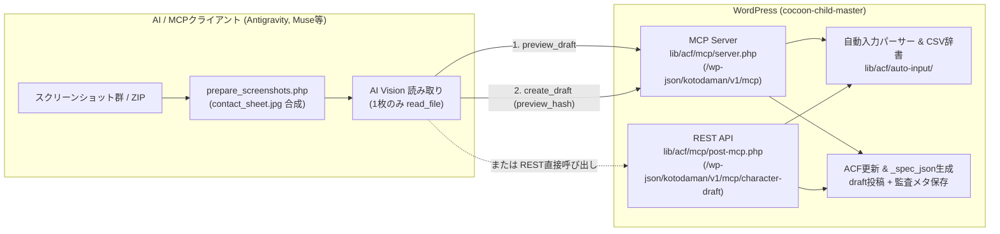

# コトダマンDB MCP ドキュメント

コトダマンDBテーマ（`cocoon-child-master`）における **MCP（Model Context Protocol）サーバーおよびキャラクター下書き自動作成機能** のドキュメント一式です。

---

## ドキュメント構成

| ドキュメント | 対象読者 | 内容 |
|---|---|---|
| **[README.md](README.md)**（本書） | 全員 | 現在のMCP実装状況、全体アーキテクチャ、クライアント接続設定、今後の拡張計画 |
| **[external-ai-setup.md](external-ai-setup.md)** | 外部AI利用者 | Muse / Claude / ChatGPT（マイGPT Actions & MCP） / Gemini CLI 等からの接続手順、使い方自動取得の仕組み、コピペ用プロンプト |
| **[character-draft-guide.md](character-draft-guide.md)** | AIエージェント / 運用者 | スクリーンショットからの下書き作成最短4ステップ（省トークン手順）、フィールド入力規則、禁止事項、運用チェックリスト |
| **[api-reference.md](api-reference.md)** | 開発者 | MCP Streamable HTTP 全9ツール＋Resources/Promptsの詳細仕様、OAuth 2.1 & アプリケーションパスワード認証、REST API仕様 |
| **[openapi.json](openapi.json)** | ChatGPT Actions 等 | ChatGPTの「Custom GPTs（マイGPT）」のActionsにそのまま貼り付けられるOpenAPI 3.1.0スキーマ |
| **[mcp-field-manual.json](mcp-field-manual.json)** | AI / 開発者 | `get_field_schema` ツールおよび `kotodaman://guide/field-manual` リソースで返却されるAI向けフィールド読み取り定義 |

* 関連ファイル:
  * [lib/acf/auto-input/AUTO_INPUT_GUIDELINES.md](../../lib/acf/auto-input/AUTO_INPUT_GUIDELINES.md): ゲーム内文言パーサーおよびCSV対応表の詳細仕様

---

## 1. 現在のMCP実装状況（ステータス総覧）

ゲームのスクリーンショットからAIが情報を読み取り、WordPress上にキャラクターの下書き（`draft`）を安全・高速・省トークンで作成・更新するための基盤が実装済みです。

### 実装済み機能

* **MCP Streamable HTTP サーバー（[lib/acf/mcp/server.php](../../lib/acf/mcp/server.php)）**
  * プロトコルバージョン `2025-03-26`（JSON-RPC 2.0）対応の単一エンドポイント（`/wp-json/kotodaman/v1/mcp`）。
  * 全9ツール実装済み：
    * 参照・検証系（`validate` スコープ）: `get_field_schema`, `get_terms`, `search_character`（雛型除外）, `get_draft`（下書き情報取得）, `validate`
    * プレビュー系（`preview` スコープ）: `preview_draft`（30分間のサーバー側入力キャッシュ・部分未解析 `warnings` 付き）
    * 作成・更新系（`create` スコープ）: `create_draft`, `update_draft`（部分更新対応・雛型保護）, `trash_draft`（雛型保護）
  * セキュリティガード：最大256KBのペイロード制限、文字数上限（キャラ名200文字、基本フィールド2000文字、自動入力4000文字、evidence 16KB）。
  * 雛型・特殊テンプレート記事（ID: `2947`, `2023`, `2637`, `2638`, `3845`, `4603`, `5294`, `3683` およびタイトルに「雛型」「雛形」を含む投稿）の変更・ゴミ箱・取得防止保護。
* **OAuth 2.1 / アプリケーションパスワード認証＆セキュリティ機構（[lib/acf/mcp/server.php](../../lib/acf/mcp/server.php)）**
  * `/.well-known/oauth-protected-resource` および `/.well-known/oauth-authorization-server` によるメタデータディスカバリ。
  * 動的クライアント登録（`/mcp/oauth/register`）、PKCE (`S256`) 必須の認可コードフロー（`/mcp/oauth/authorize`）。
  * HTTPS/ローカルループバック環境での WordPress Application Passwords 認証サポート（ブルートフォース防止付き）。
  * 権限管理：管理者・編集者は即時認可、その他の `edit_posts` 権限ユーザーは管理画面「**ユーザー > MCP利用申請**」からの承認制。管理画面から承認済みユーザーの取消（即時トークン失効）や申請却下が可能。
  * トークン管理：アクセストークン（1時間）、リフレッシュトークン（30日・トークンファミリー単位の安全ローテーション＆15秒デバウンス＆明示的失効）、失効エンドポイント（`/mcp/oauth/revoke`）。
  * 期限切れ Transient / Option の自動ガベージコレクション（GC）機構。
  * レート制限（ユーザー単位 60req/min、クライアント登録IP単位 30req/min）および `idempotency_key` による二重作成防止。
* **DBエディタ（[lib/acf/acf-editor.php](../../lib/acf/acf-editor.php) & [lib/acf/acf-editor.css](../../lib/acf/acf-editor.css)）**
  * MCP作成キャラクターに対する「🤖 AIによるdraft（要確認 / 確認済み）」レビューバナーと未解析警告一覧を表示（AIによる下書きで確認が必要である旨を明示、不要な仮画像表示は排除）。
  * 人間によるワンクリック「確認完了にする」ボタンおよび「公開 / 更新」時の確認フラグ自動解除。
* **基本フィールド保存・自動入力連携・REST API（[lib/acf/mcp/post-mcp.php](../../lib/acf/mcp/post-mcp.php)）**
  * `basic_fields`（属性・種族・レア度・文字・ステータス等）のバリデーションとACFフィールドキー（`field_xxxxxx`）変換保存。
  * タクソノミー項目の柔軟な自動解決（タームIDだけでなく日本語名・スラッグ・「火属性」「★6」等の表記ゆれを `koto_mcp_resolve_taxonomy_term_id()` で自動解決）。
  * `name_ruby` のカッコ内文字列自動除去・ひらがな正規化、`available_moji_loop` の初期属性・解放場所自動補完。
  * `auto_input`（わざ・すごわざ・とくせい・リーダー・祝福・コトワザ）を既存のCSV対応表（`lib/ゲーム内文言ーACF-対応表.csv`）および自動入力パーサーでACF構造へ変換。
  * 同一ドメイン（`www.kotodaman-db.com`）画像URLからのアイキャッチ＆進化後画像（`character_image`）自動設定（未指定時は準備中画像を自動セット）。
  * WordPress REST API 直接呼び出しエンドポイント（`POST /wp-json/kotodaman/v1/mcp/character-draft`、Base64 `screenshots` 添付・`dry_run` 対応）。
* **省トークン最適化＆テストモード制御（[lib/acf/mcp/prepare_screenshots.php](../../lib/acf/mcp/prepare_screenshots.php) ほか）**
  * 複数枚のスマホスクリーンショットやZIPから上下の不要バーをトリミングし、1枚の `contact_sheet.jpg` にタイル合成する前処理CLIスクリプト（Visionトークン75〜85%削減）。
  * `preview_draft` → `create_draft` 間のサーバー側キャッシュ復元により、作成時の巨大JSON再送を排除。
  * `test_mode` フラグ（初期値 `false`）により、通常運用時はコンパクトな件数サマリー（`parsed_counts`）のみを返し、デバッグ時（`test_mode: true`）のみ `parsed_acf` 全構造や全67フィールドスキーマを出力。

---

## 2. アーキテクチャとファイル構成



### 関連ファイル一覧

| ファイルパス | 役割 |
|---|---|
| [lib/acf/mcp/server.php](../../lib/acf/mcp/server.php) | MCP Streamable HTTP サーバー本体・ローダー（JSON-RPC 2.0 ハンドラー、モジュール集約） |
| [lib/acf/mcp/mcp-core.php](../../lib/acf/mcp/mcp-core.php) | MCP共通定数、雛型保護判定、Idempotency管理、ガベージコレクション、ロール初期化 |
| [lib/acf/mcp/mcp-auth.php](../../lib/acf/mcp/mcp-auth.php) | OAuth Bearer / Application Passwords 認証、スコープ判定、権限・承認チェック |
| [lib/acf/mcp/mcp-oauth.php](../../lib/acf/mcp/mcp-oauth.php) | OAuth 2.1 認可サーバー、動的クライアント登録、認可画面、トークン発行・失効、リフレッシュファミリー |
| [lib/acf/mcp/mcp-tools.php](../../lib/acf/mcp/mcp-tools.php) | 9ツール定義・入力引数バリデーション・実行ディスパッチ |
| [lib/acf/mcp/mcp-draft.php](../../lib/acf/mcp/mcp-draft.php) | 下書きバリデーション（`koto_mcp_validate_draft`）、既存データ抽出、未解析警告検出、アイキャッチ設定 |
| [lib/acf/mcp/mcp-schema.php](../../lib/acf/mcp/mcp-schema.php) | ACFフィールドスキーマ動的生成（`koto_mcp_field_schema`）、マニュアル読み込み |
| [lib/acf/mcp/mcp-resources.php](../../lib/acf/mcp/mcp-resources.php) | MCP Resources（ガイド文書、フィールドマニュアル）、MCP Prompts 配信 |
| [lib/acf/mcp/mcp-admin.php](../../lib/acf/mcp/mcp-admin.php) | WordPress管理画面「ユーザー > MCP利用申請」UI & アクションハンドラー |
| [lib/acf/mcp/post-mcp.php](../../lib/acf/mcp/post-mcp.php) | REST API エンドポイント（`/mcp/character-draft`）、タクソノミー自動解決、基本ACF保存、Base64スクリーンショット添付 |
| [lib/acf/mcp/prepare_screenshots.php](../../lib/acf/mcp/prepare_screenshots.php) | 複数スクリーンショット／ZIPの展開・上下トリミング・タイル合成CLIスクリプト |
| [documents/mcp/mcp-field-manual.json](mcp-field-manual.json) | `get_field_schema` に統合されるフィールド別読み取りガイド定義 |
| [lib/acf/acf-auto-input.php](../../lib/acf/acf-auto-input.php) | MCP関連ファイル（`post-mcp.php`, `server.php`）および自動入力モジュールのローダー |
| [lib/acf/auto-input/acf-auto-input-parsers.php](../../lib/acf/auto-input/acf-auto-input-parsers.php) | わざ・すごわざ・とくせい・リーダー・祝福文言の解析エンジン |
| [lib/acf/auto-input/acf-auto-input-wp-acf.php](../../lib/acf/auto-input/acf-auto-input-wp-acf.php) | ACFフィールドキー変換（`koto_convert_acf_rows_to_field_keys`）および下書き作成・更新処理 |
| [lib/ゲーム内文言ーACF-対応表.csv](../../lib/ゲーム内文言ーACF-対応表.csv) | ゲーム内文言とACF構造のマッピング辞書 |

---

## 3. 接続先とクライアント設定

### エンドポイントURL

MCPのStreamable HTTPエンドポイントは次の形式です。

```text
${KOTO_MCP_BASE_URL}/mcp
```

`KOTO_MCP_BASE_URL` には、サイトURLまたはWordPress REST API名前空間（`/wp-json/kotodaman/v1`）までを指定できます（未指定時は `rest_url('kotodaman/v1')` が使用されます）。

```text
https://kotodaman-db.com/wp-json/kotodaman/v1/mcp
http://localhost:8080/wp-json/kotodaman/v1/mcp
http://kotodaman-db.local/wp-json/kotodaman/v1/mcp
```

> [!IMPORTANT]
> 実際のトークンや認証情報は環境変数またはクライアント設定ファイルで管理し、Gitリポジトリには絶対にコミットしないでください。

### Antigravity 設定例

Antigravity CLI (`agy`) で登録する場合：

```bash
# ローカル (kotodaman-db.local)
agy mcp add --header "Authorization: Bearer <TOKEN>" kotodaman-db http://kotodaman-db.local/wp-json/kotodaman/v1/mcp

# ローカル (localhost:8080)
agy mcp add --header "Authorization: Bearer <TOKEN>" kotodaman-db http://localhost:8080/wp-json/kotodaman/v1/mcp
```

設定ファイル（`~/.gemini/config/mcp_config.json`）へ直接記載する場合：

```json
{
  "mcpServers": {
    "kotodaman-db": {
      "serverUrl": "http://kotodaman-db.local/wp-json/kotodaman/v1/mcp",
      "headers": {
        "Authorization": "Bearer <TOKEN>"
      }
    }
  }
}
```

### Muse / OAuth対応クライアント設定

Muse等のカスタムコネクタでは、MCPリソースURIに `${KOTO_MCP_BASE_URL}/mcp` を指定します。OAuthメタデータは以下のURLから自動検出されます：

* 保護リソースメタデータ: `${SITE_URL}/.well-known/oauth-protected-resource`
* 認可サーバーメタデータ: `${SITE_URL}/.well-known/oauth-authorization-server`
* ブラウザ認可画面: `${SITE_URL}/mcp/oauth/authorize`

### 環境変数

| 変数名 | 用途 | 初期値 |
|---|---|---|
| `KOTO_MCP_BASE_URL` | WordPress REST API名前空間のベースURL（`/wp-json/kotodaman/v1` は自動補完） | `rest_url('kotodaman/v1')` |
| `KOTO_MCP_TEST_MODE` | `1` または `true` で常時テスト詳細出力モードを有効化 | `false` |

---

## 4. 今後の拡張候補（ロードマップ）

現在フェーズ1（MCPサーバー・OAuth 2.1・下書き作成／更新／削除・バリデーション・省トークン最適化）が完了しています。今後の拡張候補は以下の通りです。

### 優先度：中
* **未解析文言のレポート強化**: 自動入力パーサーで一部の文言がスキップされた際、該当する原文フレーズを特定して `warnings` に詳細出力する。
* **管理画面でのプレビュー差分表示**: `update_draft` 実行前後に、既存のACF値とAI解析結果の差分をWordPress管理画面上で視覚的に比較できるUI。
* **監査ログの専用一覧UI**: 投稿メタ `_koto_mcp_audit` に保存されている作成履歴・証跡（`evidence`）を管理画面で一覧確認する画面。

### 将来構想
* **Androidエミュレータ / ADB連携による画面自動取得**: 手動スクリーンショット撮影を省き、検証環境から直接画像を収集するパイプライン。
* **代表スクリーンショットによるE2E回帰テスト**: サンプル画像セットと期待ACF JSONペアを用いた自動回帰テスト。
