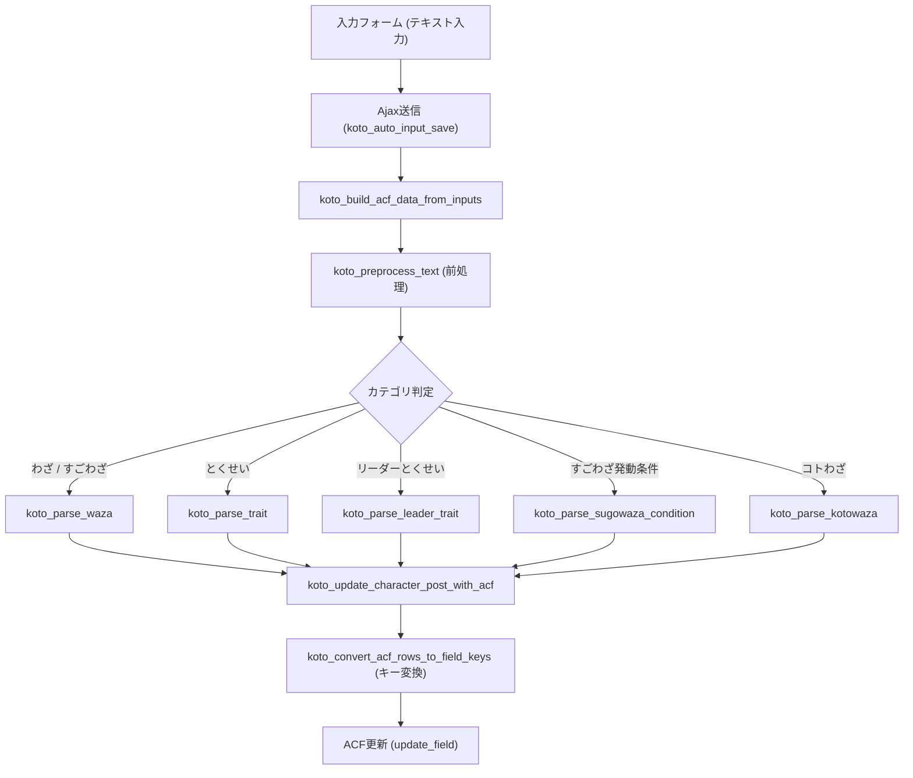

# ACF自動入力（auto-input）開発・保守ガイドライン

本書は、コトダマンDBのゲーム内スキル文言からACFフィールドデータへ自動変換・反映する機能（`lib/acf/auto-input/`）のアーキテクチャ、処理フロー、文言正規化ルール、トラブルシューティングおよび保守知見をまとめたドキュメントです。

---

## 1. モジュール構成と役割

| ファイル | 役割 |
| :--- | :--- |
| `acf-auto-input-ajax.php` | Ajaxエンドポイント（`wp_ajax_koto_auto_input_save` など）。受信・レスポンスを担当。 |
| `acf-auto-input-parsers.php` | 文言解析のメインロジック。各カテゴリ（わざ、とくせい、リーダー等）のパーサー関数を実装。 |
| `acf-auto-input-helpers.php` | CSV辞書読み込み、正規表現パターン生成、前処理、JSON変数置換、タームID解決などの共通補助関数。 |
| `acf-auto-input-wp-acf.php` | 解析済みデータからACFフィールドキー（`field_xxxxxx`）への再帰変換、DB更新・新規投稿作成を担当。 |
| `lib/ゲーム内文言ーACF-対応表.csv` | ゲーム内文言パターンとACF投入JSONの対応マッピング辞書。 |

---

## 2. 全体処理フロー



---

## 3. わざ・すごわざ解析（`koto_parse_waza`）の詳細フロー

```mermaid
flowchart TD
    W1["入力文言 (前処理後)"] --> W2["1. シフトタイプ判定 (waza_shift_rows)"]
    W2 -->|前方一致あり| W3["shift_type 抽出 & テキスト前方消費"]
    W2 -->|なし| W4["通常処理へ"]
    W3 --> W4
    W4 --> W5["2. パート分割 (丸数字 / 改行)"]
    W5 --> W6["各パートのループ"]
    W6 --> W7["3. わざ追加条件の抽出 (waza_condition_rows)"]
    W7 --> W8["4. 効果の抽出 (+ や 、さらに で preg_split)"]
    W8 --> W9{"効果 ($all_effects) が1件以上あるか？"}
    W9 -->|Yes| W10["group_loop 行を生成"]
    W9 -->|No (空)| W11["行をスキップ (未対応・不正行の除外)"]
    W10 --> W12{"属性シフト (attr) か？"}
    W12 -->|Yes| W13["各シフト属性ごとに結果行を複製・attack_attr上書き"]
    W12 -->|No| W14["終了"]
    W13 --> W14
```

### ① 前処理（`koto_preprocess_text`）のルール
* **英数・記号の統一**: 全角英数を半角へ、`％` → `%`、`＋` → `+`、`｜` → `|`、`（）` → `()` へ正規化。
* **句点「。」の正規化（最重要）**:
  * 「。」を単純に消去（空文字）すると、文と文（メイン効果と追加条件など）が直結して完全一致マッチに失敗する。
  * `。(?:さらに|また(?:は)?)[、,]?` → 効果連結（`+`）へ変換。
  * 残る「。」 → 改行（`\n`）へ変換し、パート分割（`koto_split_by_circled_numbers`）で文ごとに分離されるようにする。
* **「、さらに」の保護**: 効果の行分割トークンとして機能するため、除外文言（`$ignore_texts`）の削除処理中も一時プレースホルダで保護。

### ② シフトタイプと属性シフトの仕様
* **先頭マッチング**: `自身の属性に応じて{$attr}属性の時は【】、{$attr2}属性の時は【】に効果が変化する` などを前方一致（`prefix`）で抽出し、残りの文言を後続処理へ渡す。
* **属性の自動上書きと複製（`koto_duplicate_results_for_shift_attrs`）**:
  * 属性シフト（`sugo_shift_type === 'attr'`）の場合、パースされた各効果行をシフト属性（例: 闇・水、光・火）の数だけ複製する。
  * 複製時、攻撃効果（`attack`）の `attack_attr` は先頭シフト文言から抽出された属性IDで自動的に上書きされる。
  * **そのため、本文中の属性表記（例: `【闇｜水】属性` や `【の光|火】属性`）にノイズや複数属性が含まれていても、本文中の属性値は無視され、正しい属性IDが確実に設定される。**

### ③ わざ追加条件（`waza_add_cond_loop`）の複数条件ループ抽出
* 「`6文字以上、または15コンボ以上の場合、追加で...`」のように、`または` / `もしくは` 区切りで複数の追加条件が並ぶ文言に対応。
* 各パートの先頭で区切り文字（`、`・`,`・`・`）や `または` / `もしくは` を除去しながら、`わざ条件` 行が前方一致（`prefix`）でヒットしなくなるまでループ抽出し、`waza_add_cond_loop` へ格納する。
* 前処理（`koto_preprocess_text`）では `、または` を一括削除せず、直前の条件末尾の読点（`、`）や変数境界を維持したままパーサー側のループで順次消費する。

### ④ 不完全行の除外ガード
* わざ・すごわざにおいて、「効果（`sugo_detail_loop`）がないのに条件（`waza_add_cond_loop`）だけが存在する行」は不正データである。
* 稀なパターンや未対応の追加効果文言（例: 七属性1回攻撃など）がある場合でも、効果が空（`empty($all_effects)`）であればグループ行を生成せずスキップする。
* これにより、前半の通常効果（デバフ＋5回攻撃など）のみが安全かつ正確に自動入力される。

### ⑤ 連撃表記の正規化（`〇属性〇回攻撃` と `〇属性の〇回攻撃` の両対応）
* ゲーム内テキストにおいて「水属性の8回攻撃」と「水属性8回攻撃」の双方が存在するため、`koto_preprocess_text` で `(属性)(各?[0-9０-９]+回攻撃)` を `$1の$2` へ前処理正規化し、CSV側にも「の」なしテンプレートを配備して完全両対応。

---

## 4. とくせい・リーダーとくせいの解析仕様

### ① とくせい（`koto_parse_trait`）
* **条件部と効果部の分離**:
  * 条件部: 前方一致（`prefix`）でマッチさせてテキストを前方から消費。
  * 効果部: 後方一致（`suffix`）でマッチ。
* **祝福・EX祝福の統合**: スコープ「祝福」は通常祝福とEX祝福の両方を扱い、pt条件や解放場所をマッピング。

### ② リーダーとくせい（`koto_parse_leader_trait`）
* **キャラ数倍率（パターンA）**: 「×」を含む文言を検知し、`per_unit_loop` 構造を構築。
* **固定値・条件付き（パターンB）**: 条件（`ls_cond_loop`）→ 対象（`ls_target_chara_loop`）→ 効果（`ls_status_loop`）を順次抽出して `ls_type` ごとに仕分け。
* **対象キャラの文脈引き継ぎ（フォールバック）**: 「神種族と英種族のHP100%UP・「え」を含む言葉を作成したときATKが200%UP」のように、文頭にのみ対象キャラが記述され後続の条件付き効果で対象が省略されている場合、直前の抽出対象（`$last_targets`）を自動的に引き継ぎ反映する。

---

## 5. CSV辞書（`ゲーム内文言ーACF-対応表.csv`）の記法ルール

1. **プレースホルダ命名規則**:
   * `{$val}`: 数値（`[0-9０-９]+`）
   * `{$attr}`: 属性名（タームIDへ変換。`【` `】` 除去済み）
   * `{$species}`: 種族名（タームIDへ変換）
   * `{$affiliation}`: 所属グループ名（タームIDへ変換）
   * `{$moji}`: 文字名（タームIDへ変換）
   * `{$at_prefix_...}`: 攻撃倍率プレフィックス（`koto_get_attack_map` で変換）
   * `{$prefix}`: バフ/デバフ段階（`koto_get_buff_prefix_map` で変換）
   * `{$waza_target}`: 攻撃対象（`single_oppo`, `all_oppo` 等）
   * `{$waza_character_target}`: バフ/効果対象（`self`, `all_ally`, `hand_ally` 等）
2. **JSONテンプレート内の式計算**:
   * `"$val*1000"` や `"$val/2"` などの四則演算式を記述可能（`koto_resolve_numeric_expressions` で評価）。
3. **複数行のパイプ区切り**:
   * 1つの文言で複数のACF行を生成する場合は `{"..."}|{"..."}` とパイプで結合。

---

## 6. ACFフィールド保存時の注意点（重要）

* **フィールドキーでの操作**:
  * サブフィールド名の同名衝突（例: トップレベルの `sugowaza_condition` と Repeater内の `sugowaza_condition`）を防ぐため、必ず `koto_get_top_level_character_acf_field()` および `koto_convert_acf_rows_to_field_keys()` で `field_xxxxxx` キーに変換して更新する。
* **キャッシュクリア**:
  * 同一プロセスでの更新競合を防ぐため、前後に `clean_post_cache($post_id)` および `acf_flush_value_cache($post_id)` を実行する。
* **ローカルDBと本番DBのデータ差**:
  * ローカル環境にはタクソノミー（`attribute`, `available_moji`, `affiliation`）のタームが一部しか登録されていない場合がある。
  * ターム未存在時は `get_term_by` が null を返し空配列になるため、検証時は必要に応じてタームを作成してテストすること。

---

## 7. トラブルシューティング（自動入力が入らない時のチェックリスト）

1. **完全一致でマッチしているか？**:
   * `koto_preprocess_text` 後のテキストが CSV の文言テンプレートと完全に一致しているかを確認。
   * 文の途中に句点「。」や読点「、」が残って余計なノイズになっていないか？
2. **シフトタイプがテキストを巻き込んでいないか？**:
   * シフト文言（`waza_shift_rows`）のマッチ後、後続テキストの先頭が正しく `trim` されているか？
3. **`sugo_detail_loop` が空になっていないか？**:
   * 効果文言が CSV 辞書に未登録の場合、効果が0件になる。
   * 条件だけあっても効果が空なら追加されない仕様になっているか確認。
4. **属性・文字・所属のタームが存在するか？**:
   * `attribute`, `available_moji`, `affiliation` タクソノミーに対象のタームが存在するか確認。

---

## 8. 動作確認・回帰テスト用サンプル文言集

機能改修やCSV辞書更新時の回帰テストに利用できる、各カテゴリの主要な分岐・特殊変換を網羅したテスト文言集です（`php lib/acf/test_auto_input.php` で一括実行可能）。

### ① わざ・すごわざ（`わざ`：全12件）
1. **「または」区切り複数条件（文字数＋コンボ）＋クリティカル率バフ＋単体攻撃**
   ```text
   6文字以上、または15コンボ以上の場合、追加でこのターン自身のクリティカル発生率を上昇＋敵単体に超強力な水属性攻撃
   ```
2. **「または」区切り複数条件（HP条件＋テーマ条件）＋全体ATKバフ＋全体攻撃**
   ```text
   HPが50%以下、または「いきもの」テーマのことばを作った場合、追加でこのターン攻撃する味方全体のATKを少し強化＋敵全体に超絶強力な火属性攻撃
   ```
3. **「または」区切り3条件（同時発動＋文字数＋コンボ）＋被ダメ増加デバフ＋連撃**
   ```text
   同時に水属性のコトダマンがわざ・すごわざを発動させていた、または6文字以上、または12コンボ以上の場合、敵単体に被ダメージ増加状態を2ターン付与＋敵単体に超絶強力な水属性の8回攻撃
   ```
4. **通常効果＋句点「。」区切りの複数条件付き追加効果**
   ```text
   敵単体に超絶強力な木属性攻撃。5文字以上、または10コンボ以上の場合、追加でHPを大きく回復
   ```
5. **文字シフト（`sugo_shift_type = moji`）＋丸数字パート分割＋複数効果**
   ```text
   自身の文字に応じて効果が変化する①「あ」の時、敵単体に爆絶強力な光属性の10回攻撃②「い」の時、手札の味方にATK強化を2ターン付与＋敵全体に超絶強力な光属性攻撃
   ```
6. **属性シフト（`sugo_shift_type = attr`）による属性ごとの行複製＆`attack_attr`自動上書き**
   ```text
   自身の属性に応じて火属性の時は【火】、水属性の時は【水】に効果が変化する①敵単体に超絶強力な火属性攻撃②手札の火属性にATK強化を1ターン付与
   ```
7. **ランダムシフト（`sugo_shift_type = random`）と `random_count` の自動付与**
   ```text
   次の2つからランダムで1つ発動する①敵単体に爆絶強力な闇属性攻撃②敵全体に超絶強力な闇属性攻撃
   ```
8. **被弾回数シフト（`sugo_shift_type = attacked`）と `sugo_shift_attacked` の階層引き上げ**
   ```text
   このコトダマンがクエスト中に敵から受けた攻撃の回数に応じて効果が変化する①攻撃を1回以上受けた場合、敵単体に強力な木属性攻撃②攻撃を3回以上受けた場合、敵単体に爆絶強力な木属性攻撃
   ```
9. **倍率テーブル（`maltiplier_table: moji_converged`）の自動生成＋全属性有利（`omni_advantage`）**
   ```text
   敵全体に文字数に応じて威力が上昇し、敵の数が少ないほど威力が大きく上昇する全属性有利となる天属性攻撃
   ```
10. **フィールド展開（`battle_field`）＋連携攻撃（`coop_attack`）**
    ```text
    水属性威力20%・神種族威力20%UP効果のフィールドを3ターン展開＋このターンわざ・すごわざを発動させた「クロニクル」のコトダマンと同じ属性で敵単体に超絶強力な攻撃
    ```
11. **パイプ分割わざ条件（同時発動：グループまたは種族）＋重圧（`preassure`）＋乱打（`random_oppo`）**
    ```text
    同時に「クロニクル」または神種族のコトダマンがわざ・すごわざを発動させていた場合、敵単体に重圧1を2ターン付与＋9回、ランダムな敵に超絶強力な冥属性攻撃を与える
    ```
12. **連撃表記の「の」省略（`〇属性〇回攻撃`）**
    ```text
    敵単体に超絶強力な水属性8回攻撃
    ```

### ② とくせい（`とくせい`：全11件）
1. **単一条件（文字数）＋自身の威力UP**
   ```text
   5文字以上の言葉を作成した時、自身の威力が50%UP
   ```
2. **複数条件（HP条件＋コンボ条件）＋ダメージ上限増加**
   ```text
   HPが80%以上の時、10コンボ以上で自身の1回の攻撃で与えることができるダメージの上限を300000増加
   ```
3. **スーパーギミック（ギミック＋文字変換追加のパイプ分割生成）**
   ```text
   チェンジマスの効果を受けない。さらにチェンジマスがある場合、文字変換に「あ・い」が追加される
   ```
4. **ドロー時ステータス強化付与**
   ```text
   ドロー時に味方のATKを少し強化を1ターン付与
   ```
5. **丸数字による複数とくせい（実体化時コンボ＋ ＆ 被弾時ATK上昇）**
   ```text
   ①実体化時に、ことばの判定でコンボの数を+2する②このコトダマンが敵からの攻撃を受けた場合、ATKが150上昇する(上限4回)
   ```
6. **他者へのとくせい付与（`whose_trait` キー変換 ＆ 文字条件 `char`）**
   ```text
   デッキ内の火属性の文字が「あ・い・う」の時、そのコトダマンの威力が50%UP
   ```
7. **デッキ内キャラ1枚につきステータスUP（`per_unit_tf` ＆ `deck_ally_field_group` キー変換）**
   ```text
   デッキの神種族1枚につきATKを40UP
   ```
8. **パイプ分割による複数ステータス同時UP（所属グループのATK UP・状態異常耐性）**
   ```text
   デッキ内の「クロニクル」のATK15%UP・呪い耐性50%
   ```
9. **スーパーアタックコア（`need_combos` 4段階展開）＆ヒールコア（式計算 `$val*1000`）**
   ```text
   ①このコトダマンを含むことばで【10|15|20|25】コンボ達成した場合、このターン攻撃する味方の行動前、自身にATKを【少し強化|強化|大きく強化|超大きく強化】を与える②このコトダマンを含むことばで10コンボ達成した場合、敵ターン終了時、HPを少し強化
   ```
10. **新とくせい系（看破 `see_through` ＆ 共鳴 `resonance`）**
    ```text
    ①自身が実体化時に、敵全体に被ダメージ少し増加状態を1ターン付与し、このターン敵全体が受けるダメージの上限を100000増加②自身が実体化した文字と同じ文字のコトダマンが実体化している場合、ことば読み上げ完了後にこのターン攻撃する自身と、自身と同じ文字のコトダマンの威力が30%UP・1回の攻撃で与えることができるダメージの上限を200000増加
    ```
11. **単体単発攻撃補正＋上限解放複合（`single_shot`）＆すごわざ発動条件追加（`sugowaza_condition`）**
    ```text
    ①デッキ内の水属性の単体単発攻撃で敵に与えるダメージが30%UP・単体単発攻撃で与えることができるダメージの上限を200000増加②自身のすごわざ発動条件に「いきもののことば」を追加する
    ```

### ③ リーダーとくせい（`リーダーとくせい`：全9件）
1. **編成条件＋コンボ条件＋固定倍率・状態異常耐性（パターンB）**
   ```text
   デッキ内に火属性が6体以上いる場合、10コンボ以上で火属性のHP120%・ATK260%・睡眠耐性100%UP
   ```
2. **同時文字作成条件（複数属性）＋全体固定倍率**
   ```text
   光・闇属性が同時に文字を作ったとき、デッキ内全員のHP100%・ATK240%UP
   ```
3. **WAVE進行加算条件（上限WAVE指定あり・`leader_text` 前方復元処理）**
   ```text
   クエスト中、WAVEを進めるたび火属性のATKが40%を加算する(3WAVE目まで発動)
   ```
4. **指定文字含有条件＋クリティカル率・クリティカル威力UP**
   ```text
   「あ・い・う」を含むことばを作成した時、デッキ内全員のクリティカル発生率30%・クリティカル威力50%UP
   ```
5. **キャラ数倍率（パターンA：`per_unit_loop`）**
   ```text
   デッキ内全員のHPを「クロニクル」×20%・ATKを「クロニクル」×20%・汚染耐性を「クロニクル」×20%UP
   ```
6. **複数の編成条件（属性＋種族）の同一 `ls_cond_type` (`chara_num`) へのANDマージ処理**
   ```text
   デッキ内に水属性が4体以上・神種族が4体以上いる場合、水属性のHP140%・ATK280%UP
   ```
7. **特殊 `ls_type` の仕分け（通常固定値 `fixed` ＋ 腐敗 `corruption` ＋ ダメージカット `damage_cut`）**
   ```text
   ①火属性のHP120%・ATK240%・混乱耐性100%UP②火属性がわざ・すごわざ・コトわざでダメージを与えたとき、腐敗20%を2ターン付与③火属性が受ける5000以下のダメージを無効化
   ```
8. **その他の特殊 `ls_type`（オーバーヒール `over_heal`・追加ATK）**
   ```text
   ①木属性がHP上限を超えて回復で固定ダメージ②木属性のATKが追加で40%UP
   ```
9. **中黒区切りの複数効果（対象引き継ぎ＋文字含有条件＋ATK上昇）**
   ```text
   神種族と英種族のHP100%UP·「え」 を含む言葉を作成したときATKが200% UP
   ```

### ④ すごわざ発動条件（`すごわざ発動条件`：全7件）
1. **丸数字区切りの複数OR条件（文字数・コンボ）**
   ```text
   ①4文字以上②10コンボ以上
   ```
2. **テーマ条件＋頭文字指定＆文字数の複合条件（AND条件）**
   ```text
   ①いきもののことば②「あかさ」からはじまる4文字以上
   ```
3. **語尾指定＋文字数の複合条件（AND条件）**
   ```text
   「んい」でおわる5文字以上
   ```
4. **指定文字含有＋コンボ数の複合条件（AND条件）**
   ```text
   「し」を含む12コンボ以上
   ```
5. **省略記法（`m`=文字、`c`=コンボ、`t`=のことば）**
   ```text
   ①4m②10c③いきものt
   ```
6. **省略記法の文字指定系（`s`=からはじまる、`e`=でおわる、`i`=を含む）**
   ```text
   ①あかさs4m②んいe5m③しi12c
   ```
7. **頭文字＋語尾＋文字数の3条件AND結合**
   ```text
   「あ」からはじまる「ん」でおわる5文字以上
   ```
